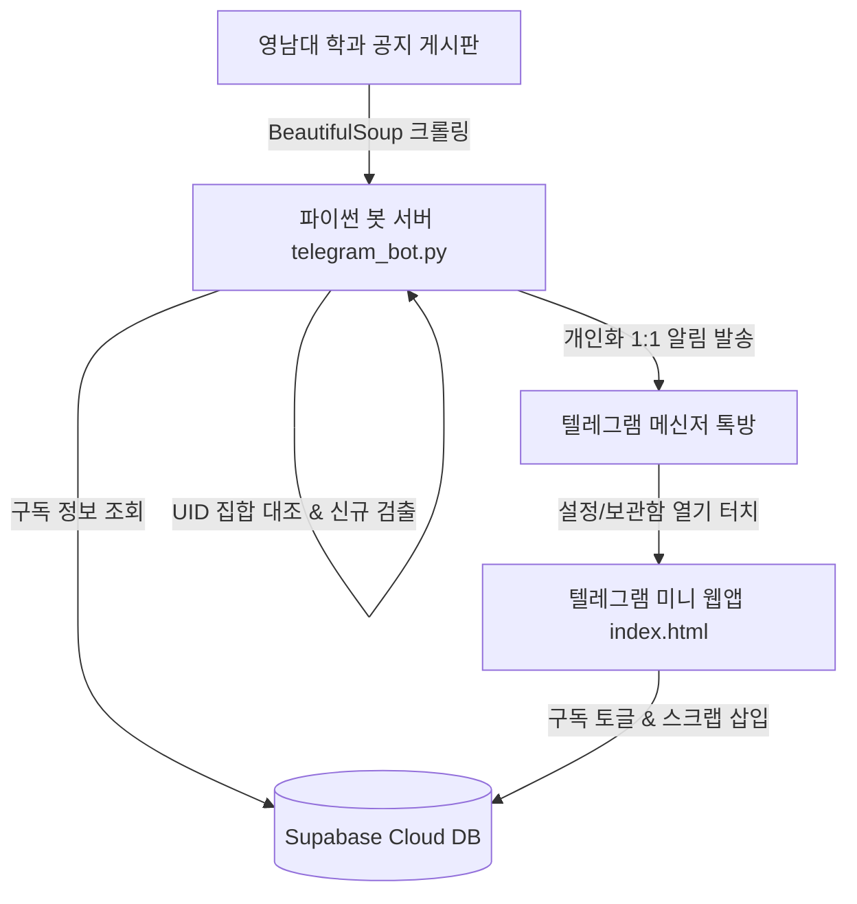

# 🤖 영대소식 알림 및 스크랩 봇 (YU Notice Bot)

> **영남대학교의 다양한 학과 공지사항을 실시간 크롤링하여, 사용자가 선택한 전공에 맞게 개인화된 텔레그램 알림을 발송하고 마음에 드는 공지를 즉시 스크랩 보관할 수 있는 텔레그램 미니앱 연동 서비스입니다.**

<br>

## 💡 서비스 아키텍처 (Architecture)



<br>

## ✨ 핵심 기능 (Key Features)

### 1. 다중 학과 크롤링 및 중복 검출 엔진
* **개인화 필터링**: 사용자가 구독 중인 학과(영대소식, 컴퓨터학부, SW중심대학, 전자공학, 기계공학 등) 정보만 선택적으로 선별 수집합니다.
* **고유 ID(UID) 집합 대조 알고리즘**: 상단에 고정된 Pinned(고정) 공지글을 피해 신규 일반 공지만 정확히 가려내기 위해, 글 제목 대신 상세 링크의 고유 글 번호(`articleNo`)를 대조하여 중복 알림을 100% 방지합니다.

### 2. 텔레그램 미니 앱(WebApp) UI 연동
* **단정하고 미니멀한 UI**: 브라우저 기본 폰트 대신 구글 Outfit 폰트와 HSL 다크 네온 테마를 사용한 premium UI/UX를 제공합니다.
* **알림 구독 토글**: 복잡한 명령어 필요 없이 모바일 iOS 토글 버튼으로 원하는 학과 알림을 실시간 ON/OFF 할 수 있습니다.
* **스크랩(북마크) 보관함**: 수신된 공지 하단의 `[📌 이 공지 스크랩하기]` 버튼을 누르면 즉시 개인 DB 보관함에 영구 스크랩되며, 미니앱 내에서 즉시 모아보고 삭제할 수 있습니다.

### 3. 고도화된 안정성 및 보안 체계
* **이중 크롤링 방지 캐싱**: 10분 주기 기동 시 한 번 긁어온 수집 데이터를 메모리 캐시(`crawled_cache`)에 유지하여 대학교 서버에 무리를 주지 않고 대폭 자원을 아낍니다.
* **환경변수 자가 진단(Guard Clause)**: 시작 즉시 필수 정보 누락 여부를 판단하여 시스템 오작동을 자가 예방합니다.
* **철저한 기밀 보안**: 봇 토큰 및 DB 패킷 기밀을 모두 `.env` 파일에 격리하여 퍼블릭 깃허브 공개 시 보안 유출 위협을 0%로 통제합니다.
* **관리자 긴급 SOS 사이렌**: 크롤링 실패 등 비정상 동작 감지 시, 관리자 텔레그램 계정으로 실시간 장애 로그 경보를 자동 전송합니다.

<br>

## 🛠️ 기술 스택 (Tech Stack)

* **Backend**: `Python 3.12`, `BeautifulSoup4`, `Requests`, `python-dotenv`
* **Database**: `Supabase` (PostgreSQL)
* **Frontend**: `HTML5`, `CSS3 (Vanilla)`, `JavaScript (ES6)`, `Telegram WebApp SDK`
* **Infrastructure**: `Azure VM`, `Crontab` (10분 주기 배치), `GitHub Pages`

<br>

## 📂 파일 구조 (Directory Structure)

```text
├── telegram_bot.py      # 크롤링, DB 연동, 텔레그램 알림 발송 메인 백엔드
├── index.html           # 텔레그램 미니앱 설정 및 스크랩 보관함 프론트엔드
├── last_notices.json    # 중복 수집 필터링용 직전 공지 ID 목록 캐시 파일
├── .gitignore           # .env 등 기밀 정보의 깃 업로드 차단 설정
├── .env                 # 토큰, Supabase URL/Key 등 로컬/서버용 기밀 환경변수
└── README.md            # 프로젝트 개요 및 가이드 문서
```

<br>

## 🚀 설치 및 가동 방법 (Installation)

### 1. 로컬 환경 변수 설정
로컬 및 서버 루트 디렉토리에 `.env` 파일을 생성하고 봇 정보를 적재합니다:
```env
TELEGRAM_TOKEN=your_telegram_bot_token_here
ADMIN_CHAT_ID=your_chat_id_here
SUPABASE_URL=your_supabase_url_here
SUPABASE_KEY=your_supabase_anon_key_here
WEBAPP_URL=https://<your_github_username>.github.io/<your_repository_name>/
```

### 2. 의존성 패키지 설치
```bash
pip3 install requests beautifulsoup4 supabase python-dotenv
```

### 3. 크론탭(Crontab) 주기 배치 등록 (평일 9시 ~ 17시 50분, 10분 주기)
VM 서버의 스케줄러에 등록하여 24시간 무인 가동을 완수합니다:
```bash
*/10 9-17 * * 1-5 cd /home/nohhyun03 && python3 telegram_bot.py > /dev/null 2>&1
```
